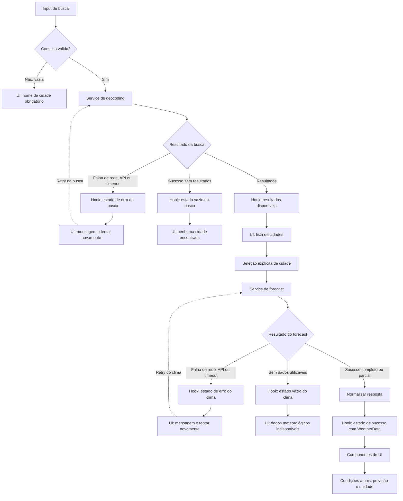

# Weather App — Plano Técnico

Fonte da verdade: [especificação do produto](../specs/weather-app-spec.md).

## Architecture

Aplicação web client-side em React, sem backend, conta ou persistência de preferências. Dividir a aplicação em quatro camadas com dependências em uma única direção: apresentação → orquestração → acesso a dados; funções puras são reutilizadas sem depender dessas camadas.

```text
components/  apresentação React, eventos e acessibilidade
    │ chama ações e renderiza estado
    ▼
hooks/       orquestração de fluxo e estado da tela
    │ chama operações de dados
    ▼
services/    HTTP Open-Meteo, validação e mapeamento de respostas
    │ reutiliza quando apropriado
    ▼
lib/         funções puras de conversão, formatação e domínio
```

`components/` não conhece endpoints nem interpreta JSON externo. `hooks/` controla busca, seleção, carregamento, erro, retry e concorrência, expondo estado e ações à tela. `services/` encapsula transporte, timeout, validação de respostas e conversão para os tipos internos. `lib/` contém cálculos e transformações determinísticas sem efeitos colaterais, como conversão de temperatura, mapeamento WMO e formatação de data. Tipos compartilhados ficam em `types/`.

Respostas externas não devem ser consumidas diretamente pelos componentes; valores ausentes são preservados para apresentação explícita como indisponíveis. O navegador não solicita geolocalização.

**Rastreabilidade:** FR-01 a FR-06; NFR-01, NFR-04, NFR-06 e NFR-07.

## Tech Stack

- **React 19 e TypeScript strict:** stack instalada no projeto; componentes e tipos explícitos mantêm a solução tipada.
- **Vite:** desenvolvimento e build da aplicação.
- **Tailwind CSS:** estilos responsivos conforme a stack do projeto.
- **Vitest e Testing Library:** testes unitários e de componentes.
- **Playwright:** testes E2E e validação de viewports e fluxos de usuário.
- **Intl do navegador:** formatação pt-BR de números e datas, usando explicitamente o fuso retornado pela API.

Manter Celsius como representação dos dados recebidos e converter para Fahrenheit somente na apresentação. Isso permite alternar a unidade sem nova chamada. Não adicionar biblioteca de estado, cliente HTTP ou camada de componentes sem necessidade demonstrada.

**Rastreabilidade:** FR-04; NFR-01, NFR-04, NFR-05 e NFR-06; AC-10 e AC-11.

## Project Structure

Estrutura proposta para separar apresentação, estado, integração e lógica pura:

```text
src/
  App.tsx
  components/
    SearchForm.tsx       # entrada, envio e acessibilidade da busca
    CityResults.tsx      # resultados e seleção explícita da cidade
    CurrentWeather.tsx   # condições atuais e referência temporal
    ForecastList.tsx     # cinco resumos diários
    ForecastCard.tsx     # apresentação de um dia da previsão
    UnitToggle.tsx       # controle da unidade apresentada
    states/
      LoadingState.tsx   # status de carregamento
      ErrorState.tsx     # mensagem de erro e retry manual
      EmptyState.tsx     # título e dica para resultado vazio
  hooks/
    useWeather.ts        # estado e coordenação dos fluxos da tela
  services/
    geocoding.ts         # requisição e mapeamento de resultados de cidade
    weather.ts           # forecast, timeout e normalização do payload
  lib/
    temperature.ts       # conversão e formatação da temperatura
    time.ts              # formatação de datas e referência/fuso
    format.ts            # rótulo do dia e data local em pt-BR
    weatherCodes.ts      # rótulos pt-BR e ícones decorativos para códigos WMO
  types/
    weather.ts           # City, CurrentWeather, ForecastDay e WeatherData
tests/
  ... testes unitários e de componentes
  e2e/
    weather.spec.ts
```

Manter `App.tsx` como composição da tela, sem lógica de transporte ou regras de domínio. `useWeather` coordena busca, seleção, consulta e estados; serviços são o único ponto de acesso à API; funções em `lib/` recebem valores e retornam resultados sem alterar estado ou fazer I/O. Componentes recebem dados e callbacks tipados, permitindo renderizá-los com props controladas nos testes. Não criar subcamadas ou abstrações genéricas sem necessidade.

Estados de apresentação são separados em três componentes sem acesso a dados:
`LoadingState` recebe `message` opcional (padrão “Carregando...”) e usa
`role="status"`; `ErrorState` recebe `message` e `onRetry`, anuncia a mensagem
com `role="alert"` e tem botão nativo “Tentar novamente”; `EmptyState` recebe
`title` e `hint`, sem indicar falha nem oferecer retry. O chamador escolhe a
mensagem de busca, clima ou timeout e renderiza apenas o estado atual.

**Rastreabilidade:** FR-01 a FR-06; NFR-04 e NFR-06.

## Data Model

Contratos internos principais. Campos potencialmente ausentes na resposta permanecem `null`; não usar zero nem dados anteriores como fallback.

```ts
export type Unit = 'celsius' | 'fahrenheit';

export interface City {
  id: string;
  name: string;
  admin1: string | null;
  country: string | null;
  latitude: number;
  longitude: number;
}

export interface CurrentWeather {
  temperatureC: number | null;
  weatherCode: number | null;
  humidityPercent: number | null;
  windSpeedKmh: number | null;
  precipitationMm: number | null;
  pressureHpa: number | null;
  referenceTime: string | null;
  timezone: string | null;
  utcOffsetSeconds: number | null;
}

export interface ForecastDay {
  date: string;
  weatherCode: number | null;
  temperatureMinC: number | null;
  temperatureMaxC: number | null;
  precipitationProbabilityPercent: number | null;
}

export interface WeatherData {
  current: CurrentWeather;
  days: ForecastDay[];
}

export type SearchState =
  | { status: 'idle' }
  | { status: 'loading'; query: string }
  | { status: 'success'; query: string; results: City[] }
  | { status: 'empty'; query: string }
  | { status: 'error'; query: string; error: RequestError };

export type WeatherState =
  | { status: 'idle' }
  | { status: 'loading'; city: City }
  | { status: 'success'; city: City; data: WeatherData }
  | { status: 'empty'; city: City; message: string }
  | { status: 'error'; city: City; error: RequestError };
```

`City.id` deve ser estável para os resultados recebidos; pode ser composto dos campos de localização e coordenadas. Exibir cidade, região e país quando disponíveis; sem região ou país, usar coordenadas se disponíveis ou “Localização não informada”. Não selecionar resultados automaticamente.

O mapeamento de condições deve cobrir todos os códigos WMO suportados pelo Open-Meteo (0, 1–3, 45, 48, 51–57, 61–67, 71–77, 80–82, 85–86, 95, 96 e 99), conforme as descrições oficiais em pt-BR. Código ausente ou desconhecido é exibido como “Condição indisponível” e não invalida temperaturas disponíveis.

`referenceTime` mantém o timestamp de referência fornecido pelo provedor, não a hora de recebimento da resposta. `date` representa a data local retornada para cada dia.

O hero recebe `city`, `current` e `unit`. Usa `lib/temperature` para converter
e formatar temperaturas e `lib/weatherCodes` para rótulos e ícones decorativos
(ocultos da árvore de acessibilidade, pois a condição já tem texto).
Umidade relativa, vento a 10 m, precipitação e pressão à superfície usam,
respectivamente, %, km/h, mm e hPa, independentemente da unidade de temperatura.
Campos ausentes permanecem `null`; zero é um valor válido. O mock inclui
valores fictícios das quatro métricas. `lib/time` formata a referência do
provedor, preservando timestamps locais sem offset e convertendo timestamps
com offset para o fuso informado, sem depender do fuso do navegador.

`ForecastList` recebe `days: ForecastDay[]` e `unit: Unit`, preserva a ordem
recebida e compõe um `ForecastCard` por data (chave estável). O card recebe
`day` e `unit`, usa `lib/format.formatDayLabel` para dia da semana e data
pt-BR (interpretando a data local sem deslocamento pelo fuso do navegador),
`lib/weatherCodes` para ícone decorativo e condição textual e
`lib/temperature` para máxima/mínima. A probabilidade máxima diária de
precipitação usa %; valores ausentes permanecem `null`. Lista vazia exibe
mensagem de indisponibilidade. Grid: `grid-cols-2 sm:grid-cols-3 lg:grid-cols-5`.

**Rastreabilidade:** FR-01, FR-02, FR-03 e FR-06; AC-06 a AC-09, AC-15 a AC-20.

## Data Flow



1. Ao enviar a busca, aplicar `trim()` somente nas extremidades. Preservar acentos, espaços internos, hífens e apóstrofos. Consulta vazia não chama o serviço.
2. O serviço de geocoding busca e normaliza os resultados. Lista vazia vira estado `empty`, diferente de falha. A interface mostra os resultados e aguarda seleção explícita.
3. Selecionar uma cidade inicia a consulta do forecast para suas coordenadas e marca essa cidade como a seleção atual.
4. O serviço meteorológico normaliza condições atuais e previsões diárias. A interface apresenta os cinco dias locais a partir de hoje, mantendo campos ausentes como `null`.
5. Componentes exibem condições e valores disponíveis, identificando separadamente campos indisponíveis. A apresentação desconhecida de uma condição não oculta temperaturas válidas.
6. A unidade inicia em Celsius. Ao alternar para Fahrenheit, converter cada temperatura disponível com `F = C × 9/5 + 32`; formatar com no máximo uma casa decimal, arredondada ao décimo mais próximo, sem zeros finais. A unidade volta a Celsius após recarregar a página.

Cada operação assíncrona usa um identificador sequencial. Somente a resposta da operação vigente pode atualizar estado, dados ou erros. A requisição anterior pode ser abortada como otimização, mas a checagem do identificador é a garantia contra respostas atrasadas.

**Rastreabilidade:** FR-01 a FR-06; AC-01 a AC-11, AC-15, AC-16 e AC-18; NFR-02 e NFR-06.

## External APIs

Usar Open-Meteo diretamente no navegador, sem chave de API para este uso. Os exemplos abaixo são resumidos; campos e valores podem variar por consulta.

- **Geocoding:** `https://geocoding-api.open-meteo.com/v1/search`
  - Parâmetros relevantes: `name` (obrigatório, consulta normalizada apenas com espaços externos removidos), `count` (opcional; até 100), `language=pt` (idioma dos nomes traduzidos quando disponível) e `format=json`.
  - Um resultado pode incluir `id`, `name`, `latitude`, `longitude`, `admin1`, `country` e outros metadados opcionais, como `timezone`. Uma busca sem correspondência deve ser tratada como lista vazia.
  - Exemplo resumido:

    ```json
    {
      "results": [
        {
          "id": 2267057,
          "name": "Lisboa",
          "latitude": 38.72509,
          "longitude": -9.1498,
          "country": "Portugal",
          "admin1": "Distrito de Lisboa",
          "timezone": "Europe/Lisbon"
        }
      ]
    }
    ```

  - Mapear `id` para `City.id` (string estável), `name`, `admin1` e `country` para os campos homônimos (usar `null` quando ausentes), e `latitude`/`longitude` para coordenadas numéricas. `timezone` pode ser lido do resultado se necessário, mas a consulta de forecast usa `timezone=auto` com as coordenadas selecionadas.
- **Forecast:** `https://api.open-meteo.com/v1/forecast`
  - Parâmetros relevantes: `latitude` e `longitude` da cidade selecionada; `current=temperature_2m,weather_code,relative_humidity_2m,wind_speed_10m,precipitation,surface_pressure`; `daily=weather_code,temperature_2m_min,temperature_2m_max,precipitation_probability_max`; `temperature_unit=celsius`; `wind_speed_unit=kmh`; `precipitation_unit=mm`; `timezone=auto`; e `forecast_days=5`.
  - `timezone=auto` faz a API retornar datas e horários no fuso da coordenada; `utc_offset_seconds` e `timezone` identificam a referência temporal retornada. `forecast_days=5` solicita hoje e os quatro dias seguintes nesse calendário local.
  - Exemplo resumido:

    ```json
    {
      "utc_offset_seconds": -10800,
      "timezone": "America/Sao_Paulo",
      "current_units": {
        "temperature_2m": "°C",
        "weather_code": "wmo code",
        "relative_humidity_2m": "%",
        "wind_speed_10m": "km/h",
        "precipitation": "mm",
        "surface_pressure": "hPa"
      },
      "current": {
        "time": "2026-10-27T14:15",
        "temperature_2m": 21.4,
        "weather_code": 2,
        "relative_humidity_2m": 65,
        "wind_speed_10m": 12.5,
        "precipitation": 0,
        "surface_pressure": 1013.2
      },
      "daily_units": {
        "time": "iso8601",
        "weather_code": "wmo code",
        "temperature_2m_min": "°C",
        "temperature_2m_max": "°C",
        "precipitation_probability_max": "%"
      },
      "daily": {
        "time": ["2026-10-27", "2026-10-28", "2026-10-29", "2026-10-30", "2026-10-31"],
        "weather_code": [51, 51, 81, 81, 95],
        "temperature_2m_min": [12.5, 13.9, 15.4, 16.5, 16.8],
        "temperature_2m_max": [21.9, 23.7, 21.0, 25.4, 24.3],
        "precipitation_probability_max": [30, 40, 80, 90, 100]
      }
    }
    ```

  - Mapear `current.temperature_2m` para `CurrentWeather.temperatureC`, `current.weather_code` para `weatherCode` e `current.time` para `referenceTime`. Mapear os campos de topo `timezone` e `utc_offset_seconds` para `CurrentWeather.timezone` e `utcOffsetSeconds`.
  - Mapear `current.relative_humidity_2m`, `wind_speed_10m`, `precipitation` e `surface_pressure` para `humidityPercent`, `windSpeedKmh`, `precipitationMm` e `pressureHpa`. Preservar cada valor ausente como `null`; conferir as unidades previstas antes de normalizar.
  - Formar `WeatherData.days` percorrendo por índice os arrays `daily.time`, `daily.weather_code`, `daily.temperature_2m_min` e `daily.temperature_2m_max`: cada índice gera um `ForecastDay` com `date`, `weatherCode`, `temperatureMinC` e `temperatureMaxC`. Preservar campos ausentes como `null`; não deslocar valores entre datas quando um array estiver incompleto.
  - Mapear `daily.precipitation_probability_max` no mesmo índice para
    `precipitationProbabilityPercent` (0 a 100, ou `null` quando ausente).

Montar parâmetros com `URLSearchParams`, verificar status HTTP e validar o JSON antes da normalização. `current_units` e `daily_units` descrevem as unidades da resposta e podem ser conferidos na validação; não são campos do modelo de domínio. Não depender de campos externos além dos necessários aos contratos. Antes do lançamento, confirmar nos termos oficiais do provedor os limites de uso, atribuição exigida e cobertura para as localidades previstas; essa confirmação é bloqueio de publicação.

Documentação oficial: [Geocoding API](https://open-meteo.com/en/docs/geocoding-api) e [Weather Forecast API](https://open-meteo.com/en/docs).

**Rastreabilidade:** FR-01, FR-02, FR-03 e FR-06; AC-01, AC-07 e AC-16; riscos e questão aberta da spec sobre limites, atribuição e cobertura.

## State Management

### Incremento de demonstração sem API

Antes da integração com `useWeather`, `App` mantém `unit` (inicialmente
`celsius`) e `WeatherState` (inicialmente `idle`) em memória. Um grupo visível
“Estados de demonstração” seleciona idle/loading/empty/error/success.
A busca válida e o retry mostram exclusivamente `mockCity` e
`mockWeatherData` de Porto, independentemente do texto consultado; essa
limitação é informada na tela. Não há rede, atraso artificial, seleção
automática de resultado real ou persistência. A busca fica desabilitada
durante loading; os controles de demonstração permanecem disponíveis.
A unidade não muda ao alternar estados; componentes derivam temperaturas
na renderização sem alterar o mock. `src/main.tsx` monta a aplicação e
`src/index.css` carrega Tailwind e os estilos globais mínimos.
Este incremento demonstra a UI, não conclui busca/seleção ou integração com API.

Na composição, busca válida e retry movem o foco ao `main` rotulado após a
renderização dos resultados; controles de demonstração e de unidade preservam
o foco. Uma região persistente `aria-live="polite"` anuncia vazio, sucesso e
unidade. Busca vazia devolve o foco ao input inválido. Controles de unidade
e demonstração têm alvo mínimo de 44 × 44 CSS px e anel com offset; a borda
do input deve manter contraste de pelo menos 3:1. Os cards preservam o grid
de duas colunas em 320 px, quebrando textos longos e reduzindo padding/ícone
na base para suportar fonte ampliada sem transbordar.

Manter o estado da tela local em `useWeather`, sem biblioteca global. O hook expõe estado e ações para `App`/componentes. Separar o estado de busca do estado meteorológico para que cada fluxo tenha loading e erro próprios.

```ts
type SearchState =
  | { status: 'idle' }
  | { status: 'loading'; query: string }
  | { status: 'success'; query: string; results: City[] }
  | { status: 'empty'; query: string }
  | { status: 'error'; query: string; error: RequestError };

type WeatherState =
  | { status: 'idle' }
  | { status: 'loading'; city: City }
  | { status: 'success'; city: City; data: WeatherData }
  | { status: 'empty'; city: City; message: string }
  | { status: 'error'; city: City; error: RequestError };

type RequestError =
  | { kind: 'network' }
  | { kind: 'api'; message?: string }
  | { kind: 'timeout' }
  | { kind: 'invalid-response' };
```

O estado da tela guarda também o texto editável da busca, a cidade explicitamente selecionada e `unit: Unit`, inicializado como `'celsius'`. `empty` na busca significa requisição bem-sucedida sem resultados; `empty` no clima significa que não há dados meteorológicos utilizáveis para a cidade. Resposta parcial continua em `success`: renderizar dias e campos disponíveis e identificar individualmente os ausentes.

Armazenar temperaturas recebidas em Celsius (`temperatureC`, `temperatureMinC`, `temperatureMaxC`). Na renderização, uma função pura recebe valor-base e unidade selecionada: mantém o valor em Celsius ou calcula Fahrenheit por `F = C × 9/5 + 32`; em seguida formata em pt-BR, arredondando a no máximo uma casa decimal e removendo zeros finais. Aplicar a mesma função para temperatura atual, mínimas e máximas. A conversão é derivada, não altera os dados armazenados e não inicia novo request. A unidade existe somente em memória e volta a Celsius após recarregar a página.

Cada busca/consulta usa um identificador sequencial vigente. Ao iniciar uma operação mais recente, ignorar resultados e erros de operações anteriores; ao selecionar outra cidade, o estado meteorológico/loading/error deve corresponder somente à nova seleção.

**Rastreabilidade:** FR-01, FR-02, FR-04 e FR-05; AC-01, AC-10, AC-12, AC-13 e AC-18; requisito fora de escopo de persistência da unidade.

## Error Handling

- **Entrada vazia:** não chamar geocoding; manter a busca editável e informar que o nome da cidade é obrigatório.
- **Rede:** capturar falha de transporte/conectividade e apresentar erro recuperável da etapa correspondente; não confundir com busca bem-sucedida sem resultados.
- **Erro da API:** tratar status HTTP não bem-sucedido ou payload que indique erro como `api`; encerrar loading e mostrar mensagem apropriada à busca ou consulta meteorológica.
- **Timeout:** limitar cada request a 10 segundos com cancelamento; apresentar “A consulta demorou demais. Tente novamente.” e oferecer retry manual, sem tentativas automáticas.
- **Retry:** disponibilizar ação acessível “Tentar novamente”. Repetir somente a busca com sua consulta normalizada ou o forecast para a cidade selecionada, conforme a etapa que falhou; manter a tela sem recarregamento.
- **Resposta inválida:** se o JSON não puder ser interpretado ou faltar estrutura necessária para formar a resposta, tratar como `invalid-response`, não como sucesso vazio.
- **Resposta parcial:** preservar valores válidos e representar os campos ausentes como `null`; mostrar cada temperatura/campo indisponível sem substituir por zero, valor anterior ou erro global. Dados parciais continuam sendo `success`; códigos WMO desconhecidos exibem “Condição indisponível” sem ocultar temperaturas.
- **Sem dados meteorológicos utilizáveis:** distinguir de falha técnica com estado `empty` para a cidade selecionada, informando a indisponibilidade sem inventar valores.
- **Concorrência:** ignorar tanto erros quanto dados de requests obsoletos, para que uma seleção anterior não substitua o resultado mais recente.
- **Referência temporal:** usar “Dados referentes a” com o timestamp do provedor no fuso local e identificação inequívoca do fuso/offset. Se timestamp ou informação necessária estiver ausente, informar que a referência não foi fornecida; nunca usar o horário de recebimento.
- **Natureza dos dados:** identificar as condições como dados do modelo do provedor, não como observações locais medidas ou garantia de tempo real.

**Rastreabilidade:** FR-02, FR-03, FR-05 e FR-06; AC-08, AC-12 a AC-16, AC-18 e AC-19; NFR-03 e NFR-07.

## Testing Strategy

**Vitest e Testing Library**

- **Funções puras em `lib/`:** testar conversão C↔F, arredondamento a no máximo uma casa decimal, remoção de zeros finais e formatação pt-BR; testar todos os códigos WMO suportados e o fallback desconhecido; testar formatação de datas e timestamp em fuso explícito, inclusive campos temporais ausentes. Usar casos determinísticos, sem rede, relógio real ou renderização React.
- **Services com `fetch` mockado:** verificar URL e parâmetros de geocoding e forecast, preservação do texto pesquisado após `trim`, validação do status e do JSON e mapeamento para os tipos internos. Cobrir lista sem resultados, payload inválido, erros HTTP e de rede, timeout de 10 segundos, campos ausentes e arrays diários incompletos sem deslocar valores entre datas. Os testes não chamam a Open-Meteo real.
- **Hook de orquestração:** mockar os services e verificar transições `idle → loading → success`, `empty` e `error`; retry apenas da etapa que falhou; encerramento de loading; e descarte de resposta/erro atrasado quando outra busca ou cidade já é a atual.
- **Componentes com Testing Library:** fornecer props controladas para exercitar renderização e interação nos estados `loading`, `error`, `empty` e `success`. Verificar resultados sem seleção automática, dados parciais, temperaturas e condição indisponíveis, alternância de unidade sem nova chamada, nomes acessíveis, roles e interação por teclado.
- Manter os testes por camada: `lib/` sem mocks de rede, services com `fetch` controlado, hook com services mockados e componentes com props controladas.

**Playwright E2E**

Interceptar as chamadas de rede com fixtures controladas, mantendo o fluxo real navegador → componentes → hook → services. Cobrir: busca e seleção explícita; cidades homônimas e localização incompleta; consulta e exibição dos dados atuais e cinco dias locais; alternância de unidade e retorno a Celsius após recarga; estados vazio, erro, retry manual e timeout; resposta parcial; e resposta concorrente atrasada que não deve substituir a última cidade selecionada.

Executar os fluxos principais em viewports de 320, 375, 768, 1024 e 1440 CSS px. Em cada tamanho, verificar ausência de rolagem horizontal e disponibilidade dos controles, resultados, mensagens e dados; incluir navegação por teclado nos fluxos essenciais. A matriz completa de navegadores e a verificação WCAG 2.2 AA continuam conforme NFR-04/05, complementadas por inspeção manual de acessibilidade.

Os critérios mensuráveis NFR-02 e NFR-03 devem ser validados separadamente: medir 100 execuções de geocoding controlado e confirmar p95 de até 2 segundos sem latência externa; executar a verificação sintética de disponibilidade definida na spec. Não tratar a suíte funcional comum como prova automática dessas metas operacionais.

**Rastreabilidade:** AC-01 a AC-20; NFR-01 a NFR-07.

## Risks & Trade-offs

- **API pública acessada diretamente do navegador (escolha):** elimina backend, credenciais e infraestrutura própria, mas acopla a disponibilidade e condições de uso ao provedor. Alternativa: proxy/backend próprio, que permite cache, observabilidade e controle, mas adiciona implantação, operação e manutenção sem necessidade definida no escopo. Confirmar limites, atribuição e cobertura antes do lançamento.
- **Estado local React no hook (escolha):** suficiente para uma tela e evita dependência adicional. Alternativa: biblioteca global de estado, útil para múltiplas áreas ou estado compartilhado mais amplo, mas aumentaria configuração e conceitos sem benefício atual.
- **Celsius como dado-base e conversão no cliente (escolha):** evita novo request na alternância e mantém uma fonte coerente para todos os valores. Alternativa: solicitar Fahrenheit à API a cada troca, o que acrescenta latência e falhas possíveis e exige sincronizar respostas e unidade; não foi escolhida.
- **Sem cache persistente ou entre sessões (escolha):** mantém os dados diretamente associados às consultas atuais e respeita a unidade não persistida. Alternativa: cache em memória ou armazenamento local poderia reduzir requests, mas exigiria política de expiração/invalidação e poderia exibir dados antigos; não é necessário para o lançamento.
- **Concorrência por identificador de operação (escolha):** garante que somente a consulta mais recente atualize a interface, mesmo que abortar não impeça o processamento de uma resposta. Alternativa: depender apenas de `AbortController`, mais simples, mas insuficiente como garantia de correção em todos os casos.
- **Respostas parciais como sucesso com campos indisponíveis (escolha):** preserva informação útil sem inventar valores. Alternativa: rejeitar qualquer payload incompleto, que simplifica a apresentação mas oculta campos válidos e contraria FR-02/03.
- **Sem retentativas automáticas (escolha):** timeout/erro encerra o loading e deixa a decisão de nova tentativa com a pessoa usuária, conforme FR-05. Alternativa: retry automático poderia recuperar falhas transitórias, mas aumenta tráfego/latência e torna o comportamento menos previsível.
- **`timezone=auto` e datas locais da API (escolha):** alinha previsão e timestamp ao local selecionado. Alternativa: converter datas UTC ou usar o fuso do dispositivo pode deslocar o dia e confundir a referência temporal.
- **Testes externos determinísticos (escolha):** mocks de `fetch` e interceptação Playwright evitam dependência de rede real e tornam resultados reproduzíveis. Alternativa: testes funcionais diretamente contra Open-Meteo cobrem integração real, mas são sujeitos a latência, limites e indisponibilidade; reservar verificação real para monitoramento controlado, não para cada execução da suíte.
- **Escopo simples (escolha):** sem autenticação, backend, localização obrigatória, persistência de unidade ou abstrações extras. Alternativas ficam para necessidades futuras comprovadas, pois aumentariam manutenção sem atender requisitos atuais.
- **Dados de origem modelados e cobertura não garantida:** o timestamp não atesta observação local ou atualidade absoluta. Rotular “Dados referentes a” e não prometer tempo real ou cobertura universal.

**Rastreabilidade:** FR-02 a FR-06; NFR-03, NFR-05 e NFR-07; riscos, pressupostos, itens fora de escopo e questão aberta da spec.
